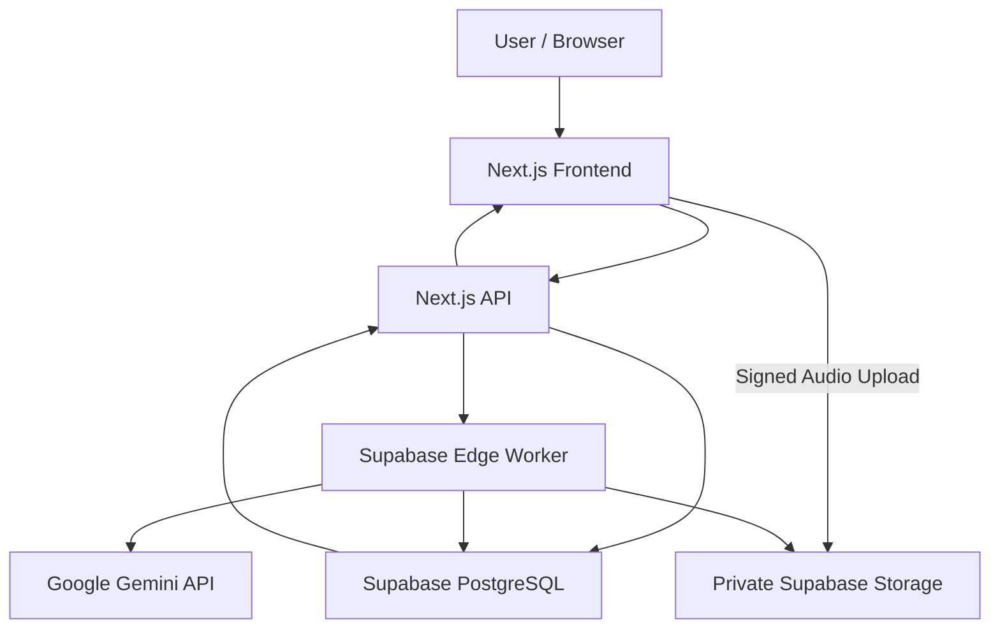

# Podwise — From Audio to Insight

**An AI-Powered Podcast Companion**

Podwise transforms podcast recordings and transcripts into structured, interactive learning experiences. Using artificial intelligence, it helps users understand long-form content, identify key insights, navigate meaningful chapters, and reinforce learning through comprehension quizzes.

Built as part of the **AI Engineering Internship Challenge at Thealon Animation Studios**, the project focuses on practical AI integration, source-grounded generation, reliable processing, secure API handling, and an accessible user experience.

---

## Project Links

| Resource                      | Link                                                                 |
| ----------------------------- | -------------------------------------------------------------------- |
| **Live Application**    | [podwise-six.vercel.app](https://podwise-six.vercel.app)              |
| **GitHub Repository**   | [Tanvir-Anjum011/podwise](https://github.com/Tanvir-Anjum011/podwise) |
| **Demonstration Video** | To Be Added                                                          |

**Project Status:** Core application implementation is complete. Final live deployment and end-to-end AI workflow verification are pending confirmation.

---

## The Problem

Podcasts contain valuable knowledge, explanations, and discussions. However, extracting useful information from long-form recordings can be time-consuming.

Listeners often struggle to:

- Identify the most important ideas without replaying an entire episode.
- Locate specific discussions within lengthy recordings.
- Organize content into meaningful sections.
- Review and retain information effectively.
- Convert passive listening into active learning.

## The Solution

Podwise addresses these challenges through an AI-powered workflow that converts raw podcast content into structured knowledge.

Users can submit a transcript or supported audio recording and request an AI-generated episode analysis containing an overview, key themes, takeaways, chapters, and interactive comprehension questions.

The application also supports targeted revisions so users can refine selected results without unnecessarily regenerating the entire analysis.

The intended audience includes students, researchers, podcast listeners, and independent learners who want to extract and revisit information more efficiently.

---

## Core Features

### 1. Podcast Audio and Transcript Input

Supports two input methods:

**Audio Upload**

- Supported formats: MP3, WAV, M4A.
- Maximum file size: 20 MB.
- Maximum recording duration: 20 minutes.
- Client-side audio duration checks.
- Server-side metadata validation.
- Private audio storage using Supabase.
- Permission confirmation before processing content.

**Text Transcript**

- Supports transcripts containing 100–60,000 characters.
- Optional `[MM:SS]` or `[HH:MM:SS]` timestamps.
- Chronological timestamp validation.
- Content segmentation for source references.

### 2. AI-Generated Episode Overview

Uses Google Gemini to generate structured content, including:

- Concise episode summaries.
- Main discussion themes.
- Important takeaways.
- Source evidence associated with generated insights.

The application validates output structure and source references before accepting generated results.

### 3. Navigable Chapters

Automatically organizes podcast content into meaningful sections containing:

- Descriptive chapter titles.
- Brief chapter explanations.
- References to relevant transcript segments.
- Timestamps when available.

Original transcript timestamps are preserved. Audio timestamps inferred by AI are estimates rather than guaranteed word-level alignment. Untimed transcripts do not receive fabricated timestamps.

### 4. Interactive Comprehension Quiz

Generates 3–5 multiple-choice questions based on the supplied content.

Each question includes:

- Four answer options.
- A designated correct answer.
- An explanatory answer.
- Supporting evidence from the source transcript.

The application provides answer checking and quiz scoring.

### 5. Targeted AI Revisions

Users can request meaningful changes to selected generated content, such as:

- Shortening an episode summary.
- Simplifying an explanation.
- Adjusting quiz difficulty.

Revisions reuse the existing transcript and preserve unaffected sections.

A revision history of up to 10 changes is supported.

### 6. Results and Export

The interface provides:

- Structured result views.
- Transcript navigation.
- Audio playback.
- Copy functionality.
- Markdown and JSON downloads.
- Printable notes for the selected section.
- Processing status indicators and retry options.

### 7. Browser-Based Session History

Podwise does not require traditional user accounts.

Instead, it uses randomly generated browser session capabilities to retrieve associated processing history.

Session capabilities are hashed before storage. Clearing browser storage removes the capability required to access that browser's existing history.

The application enforces a 24-hour history access window.

---

## Technology Stack

| Layer                 | Technology              | Responsibility                                        |
| --------------------- | ----------------------- | ----------------------------------------------------- |
| Frontend              | Next.js 15, React 19    | Application interface and rendering                   |
| Language              | TypeScript              | Type safety and maintainability                       |
| Styling               | CSS                     | Responsive interface                                  |
| Icons                 | Lucide React            | Interface iconography                                 |
| Backend API           | Next.js Route Handlers  | Request validation and orchestration                  |
| AI Processing         | Google Gemini           | Audio understanding and structured generation         |
| Database              | Supabase PostgreSQL     | Jobs, results, session ownership and processing state |
| File Storage          | Supabase Storage        | Private audio storage                                 |
| Background Processing | Supabase Edge Functions | Transcription, analysis and revision processing       |
| Deployment            | Vercel                  | Next.js application hosting                           |
| Testing               | Node.js Test Runner     | Validation and API tests                              |
| Version Control       | Git and GitHub          | Source management                                     |

The AI model is configurable through an environment variable, with `gemini-2.5-flash` specified as the initial default.

Actual model availability depends on the configured Google AI project and its applicable quotas.

---

## System Architecture

Podwise uses a staged processing architecture to separate frontend interaction, API orchestration, persistent storage, and AI generation.



### Processing Workflow

1. **Input Validation:** Verify transcript content or audio metadata, supported formats, and content permissions.
2. **Quota Reservation:** Check browser, network, and global request limits.
3. **Job Creation:** Create a persistent processing record in Supabase PostgreSQL.
4. **Audio Upload:** For audio inputs, generate a signed URL and upload the recording directly to private Supabase Storage.
5. **Transcription:** Process the recording through Gemini and produce transcript segments.
6. **Content Analysis:** Generate an episode overview, themes, takeaways, chapters, and quiz.
7. **Output Validation:** Validate the generated structure, quiz integrity, evidence references, and chronological information.
8. **Persistence:** Save accepted results and processing states.
9. **Presentation:** Display results in the frontend.
10. **Revision:** Process requested changes to selected result fields using the stored transcript.

### Processing States

The application manages asynchronous operations using these states:

- `awaiting_upload`
- `queued`
- `transcribing`
- `awaiting_analysis`
- `analyzing`
- `completed`
- `revising`
- `failed`

Persistent states and lease identifiers help prevent simultaneous workers from overwriting unrelated processing attempts.

Saved transcripts allow selected stages to be retried without repeating earlier successful transcription.

### Background Processing Trade-off

Supabase Edge Functions and persisted job states are used instead of introducing a separate orchestration platform.

This keeps the prototype relatively lightweight and compatible with its intended free-tier deployment.

However, the current design is **not a fully unattended durable job queue**. The browser participates in progressing certain stages, and reopening the application may be necessary to resume unfinished work.

A dedicated queue or orchestration service would be appropriate for more demanding production workloads.

---

## AI Research and Technology Selection

The challenge requires independent comparison of relevant AI tools and justified technical decisions.

Two approaches were considered.

### Option A — Google Gemini

**Approach:** Use Gemini for recorded-audio understanding, transcript generation, and structured episode analysis.

Advantages:

- Audio understanding and structured content generation within one provider ecosystem.
- Supports JSON-schema-constrained outputs.
- Simplifies integration by reducing the number of AI providers.
- Potential access through eligible free-tier quotas.
- Suitable for a compact prototype.

Limitations:

- AI-generated timestamps may not provide precise alignment.
- Free-tier availability and request limits can change.
- Generative transcription may omit or misinterpret speech.
- Application-level validation remains necessary.
- Audio processing can introduce substantial latency.

### Option B — OpenAI Speech-to-Text and Text Generation

**Approach:** Use a dedicated speech transcription model, followed by a separate language model for content analysis.

Advantages:

- Dedicated speech recognition capabilities.
- Independent selection of transcription and analysis models.
- Flexibility to evaluate transcription quality separately.
- Potentially more control over audio processing workflows.

Limitations:

- Requires coordinating multiple model operations.
- Additional integration and error-handling complexity.
- Transcription timestamps and formats depend on the selected model.
- Usage costs require separate consideration.
- Source-grounding checks remain necessary.

### Comparison

| Criterion              | Google Gemini                         | OpenAI Speech-to-Text + Generation               |
| ---------------------- | ------------------------------------- | ------------------------------------------------ |
| Audio processing       | Multimodal audio understanding        | Dedicated transcription                          |
| Content generation     | Integrated generation workflow        | Separate generation stage                        |
| Integration complexity | Lower provider integration complexity | Multiple coordinated AI operations               |
| Structured output      | Supported                             | Model-dependent structured generation            |
| Timestamp reliability  | Estimated timing requires validation  | Depends on transcription model and output format |
| Cost approach          | Eligible free-tier quotas             | Usage-based API pricing                          |
| Selected               | Yes                                   | Considered alternative                           |

### Final Decision

**Google Gemini was selected for the implemented workflow.**

The main reasons were simpler provider integration, structured generation support, and the possibility of operating within an eligible free-tier allowance.

This decision prioritizes delivering a coherent, low-cost prototype over maximizing the number of integrated AI services.

The selection does not assume unlimited free usage, guaranteed model availability, or superior output quality without empirical evaluation.

### Research Sources

The following official documentation informed the implementation decisions:

1. [Google Gemini — Audio Understanding](https://ai.google.dev/gemini-api/docs/audio)
2. [Google Gemini — Structured Outputs](https://ai.google.dev/gemini-api/docs/structured-output)
3. [Google Gemini — API Pricing](https://ai.google.dev/gemini-api/docs/pricing)
4. [OpenAI — Speech-to-Text](https://platform.openai.com/docs/guides/speech-to-text)
5. [Supabase — Background Tasks](https://supabase.com/docs/guides/functions/background-tasks)
6. [Supabase — Edge Function Limits](https://supabase.com/docs/guides/functions/limits)
7. [Vercel — Function Limits](https://vercel.com/docs/functions/limitations)
8. [OWASP — API Security](https://owasp.org/www-project-api-security/)

These references informed decisions about transcription, structured generation, deployment limits, asynchronous execution, and secure API integration.

---

## Local Development Setup

### Prerequisites

- Node.js 24.
- npm.
- A Supabase project.
- A Google Gemini API key with access to the configured model.
- Git.

### 1. Clone the Repository

```bash
git clone https://github.com/Tanvir-Anjum011/podwise.git
cd podwise
```

### 2. Install Dependencies

```bash
npm ci
```

### 3. Configure Environment Variables

Create a local environment file:

```bash
cp .env.example .env.local
```

Configure the following variables:

```env
SUPABASE_URL=your_supabase_project_url
SUPABASE_SERVICE_ROLE_KEY=your_supabase_server_key
GEMINI_API_KEY=your_gemini_api_key
GEMINI_MODEL=gemini-2.5-flash
```

| Variable                      | Description                                                    |
| ----------------------------- | -------------------------------------------------------------- |
| `SUPABASE_URL`              | Supabase project API URL                                       |
| `SUPABASE_SERVICE_ROLE_KEY` | Privileged server-only Supabase credential                     |
| `GEMINI_API_KEY`            | Server-only Gemini API credential                              |
| `GEMINI_MODEL`              | AI model identifier; optional in the application configuration |

**Security:** Never commit `.env.local`, expose server credentials in client-side code, or publish API keys in documentation.

The provided `.env.example` contains configuration placeholders.

### 4. Configure Supabase

1. Create a Supabase project on an appropriate free-tier plan.
2. Execute `supabase/schema.sql` in the Supabase SQL Editor.
3. Verify that the required tables and private storage bucket are created.
4. Deploy the Edge Function from `supabase/functions/podwise-worker/`, including both `index.ts` and `core.ts`.
5. Configure the required server and worker credentials.

The worker uses an internal bearer credential verification mechanism.

Gateway JWT verification must be disabled only for this specific worker configuration, whose handler independently verifies the expected credential before privileged operations.

Do not expose the Supabase service-role key to browser clients.

### 5. Run the Application

```bash
npm run dev
```

Open:

http://localhost:3000

### 6. Validate the Project

Run the TypeScript check:

```bash
npm run typecheck
```

Run the production build:

```bash
npm run build
```

Run the automated tests after a successful build:

```bash
npm test
```

The API tests reference the compiled Next.js server output, so the build must complete before running them.

---

## Deployment

The Next.js application is intended to be hosted on Vercel, with Supabase providing data persistence, private storage, and background processing.

### Vercel Configuration

| Setting          | Value                      |
| ---------------- | -------------------------- |
| Framework        | Next.js                    |
| Install Command  | `npm ci`                 |
| Build Command    | `npm run build`          |
| Output Directory | Framework default          |
| Hosting Plan     | Hobby / eligible free tier |

Do not configure the project as a static export. The implementation includes server-side API routes.

Configure required server environment variables through Vercel's environment settings.

For reviewer access, make sure deployment protection does not require an unavailable login.

### Deployment Verification

Before treating the deployment as production-ready:

- Verify the public URL opens without authentication.
- Confirm production environment variables are configured.
- Confirm Supabase tables, storage, and worker deployment are operational.
- Process a real transcript through the complete AI workflow.
- Test audio upload and transcription.
- Verify summary, chapters, quiz, and revision functionality.
- Check result exports and playback.
- Confirm errors are handled correctly.
- Verify that no private credentials are exposed.

**Verification status:** The final production end-to-end test remains pending confirmation.

---

## Reliability, Validation and Error Handling

Reliable AI engineering requires more than successfully calling a language model.

Podwise includes several defensive mechanisms.

### Input Validation

- Enforces transcript character limits.
- Restricts supported audio formats and file sizes.
- Checks supplied audio duration metadata.
- Validates timestamp ordering.
- Requires content permission confirmation.
- Rejects malformed requests.

### AI Output Validation

Generated output is checked for:

- Required structured fields.
- Valid source segment references.
- Supporting quotations that match the supplied transcript after whitespace normalization.
- Valid quiz answer indexes.
- Nonduplicated quiz answer choices.
- Chronological chapter references.
- Supported output lengths and collection sizes.

These checks reduce unsupported output, but exact evidence matching does not guarantee that every generated interpretation is factually correct.

### Failure Handling

The application includes handling for:

- Invalid requests.
- Missing configuration.
- API failures.
- Network timeouts.
- Provider rate limits.
- Exhausted free-tier quotas.
- Malformed AI responses.
- Expired processing jobs.
- Recoverable interrupted stages.

Failures are surfaced to users without substituting fabricated AI-generated results.

### Free-Demo Rate Limits

The current prototype documents these hourly operation limits:

| Scope       | Limit |
| ----------- | ----: |
| Per browser |     5 |
| Per network |     8 |
| Globally    |    30 |

These limits help contain free-tier usage. They are not intended to replace comprehensive production-grade abuse protection.

---

## Security and Responsible AI

Security and responsible content handling are considered throughout the design.

### Credential Security

- AI and Supabase privileged credentials remain server-side.
- Credentials are excluded from public repositories.
- Secrets are configured through local environment variables or deployment environment settings.
- Provider credentials should never appear in client-side responses or application logs.

### Data Access

- Database tables use Row Level Security with no public-client grants.
- Audio files are stored privately.
- Signed upload and read URLs have limited scope and duration.
- Browser session capabilities are hashed before storage.
- API operations check session ownership.

### Content Integrity

- User-provided transcript content is treated as untrusted input.
- Generated responses require structural and evidence validation.
- Model-generated statements are not accepted merely because they have valid JSON formatting.
- The system does not rely on fabricated fallback results.

### Responsible Content Processing

Users must confirm that they have permission to process uploaded content.

Confidential, private, or sensitive content should not be submitted to third-party AI services without suitable authorization.

The application should disclose relevant provider data-handling policies, particularly when using free-tier AI services.

### Data Retention

The current 24-hour history access window restricts API access to older processing records.

It does not automatically delete associated database records or stored audio files.

Automated retention cleanup is therefore an important future maintenance requirement.

---

## Testing and Quality Assurance

The repository contains automated tests covering input validation and selected backend API behavior.

### Test Coverage

The documented test suite includes:

**Validation Tests**

- Timestamp handling.
- Transcript input restrictions.
- Source-evidence verification.
- Quiz structure validation.
- Invalid audio timestamp handling.
- Failure-message handling.
- Long-transcript preservation.

**API Tests**

- Health endpoint behavior.
- Browser session validation.
- Cross-origin request rejection.
- Invalid input rejection.
- Transcript job creation.
- Session isolation.
- Quota enforcement.
- Signed audio upload URL generation.

### Recorded Local Verification

The existing project documentation reports:

| Check                        | Reported Result                 |
| ---------------------------- | ------------------------------- |
| Automated tests              | 16 passed                       |
| TypeScript checks            | Passed                          |
| Production build             | Passed                          |
| Real Gemini processing       | Pending end-to-end verification |
| Live Supabase worker/storage | Pending end-to-end verification |
| Complete browser workflow    | Pending end-to-end verification |

The automated API tests use mocked external services. Passing these tests does not establish that the deployed Gemini or Supabase integrations are operational.

The test and build results should be rerun against the final submission commit.

---

## Engineering Challenges and Debugging

### Issue 1 — Vercel Deployment Configuration

**Problem:** A static-output configuration conflicted with the Next.js deployment preset, producing a `NEXT_NO_ROUTES_MANIFEST` deployment error.

**Investigation:** The issue was traced to the output configuration and its incompatibility with the application's deployment requirements.

**Resolution:** The deployment configuration was changed to use Vercel's default Next.js output directory.

**Lesson:** Deployment configurations must match the runtime architecture. An application containing server-side API routes should not be configured as a static-only export.

### Issue 2 — Transcript Content Truncation

**Problem:** An earlier transcript segmentation approach could omit the beginning of an unusually long paragraph without word breaks.

**Investigation:** The issue was reproduced using a long uninterrupted input string.

**Resolution:** Regex-based extraction was replaced with explicit bounded string slicing.

A regression test was added to verify that all 2,800 characters of the test input were preserved.

**Lesson:** Text-processing logic must account for unusual input structures, not only ordinary paragraphs and sentences.

---

## Known Limitations

Podwise is a challenge prototype rather than a fully production-hardened platform.

Current limitations include:

1. **Transcription accuracy:** Generative transcription may omit, mishear, or incorrectly segment speech.
2. **Timestamp precision:** AI-generated audio offsets are estimates, not verified word-level alignment.
3. **Semantic reliability:** Exact-source evidence checking cannot guarantee correct interpretation of every statement.
4. **Audio duration validation:** Duration depends on browser decoding and supplied metadata rather than independent server-side media inspection.
5. **Processing continuity:** Certain stages depend on browser-driven continuation rather than an unattended durable queue.
6. **Abuse protection:** Browser and network request limits can be circumvented by determined attackers.
7. **Data retention:** Expired records and stored media require scheduled cleanup.
8. **Free-tier dependency:** Provider quotas, model availability, worker execution limits, and project inactivity policies may affect operation.
9. **Live verification:** Real provider calls, audio processing, revisions, and deployment behavior require final end-to-end testing.

These limitations are documented to make the implementation's boundaries and trade-offs explicit.

---

## Cost and Maintenance Considerations

The implementation is designed around a zero-budget or free-tier evaluation environment.

### Intended Hosting and API Services

| Service       | Intended Plan            |
| ------------- | ------------------------ |
| Vercel        | Hobby                    |
| Supabase      | Free                     |
| Google Gemini | Eligible free-tier quota |
| GitHub        | Free repository hosting  |

The application does not implement paid-provider fallback or automatic billing upgrades.

### Cost Drivers

Operating costs depend on:

- Number and duration of uploaded recordings.
- Number of AI transcription requests.
- Number of analysis and revision requests.
- Model token consumption.
- Supabase database and storage usage.
- Background worker execution time.
- Network and hosting usage.

A typical audio workflow requires separate transcription and analysis stages. Each requested AI revision introduces additional model usage.

Actual costs and latency depend on provider limits and measured usage. No fixed production budget or benchmark is claimed.

### Maintenance Responsibilities

Ongoing maintenance would include:

- Monitoring provider quotas.
- Reviewing model availability and deprecations.
- Updating dependencies.
- Maintaining database migrations.
- Cleaning expired jobs and uploaded recordings.
- Investigating processing failures.
- Reviewing authentication and abuse protections.
- Testing compatibility after provider updates.

---

## Three Prioritized Future Improvements

### 1. Durable Background Job Processing

**Proposed improvement:** Integrate Supabase Queues and scheduled workers, or a dedicated orchestration service such as Inngest.

**Why:** The current workflow can depend on an active or reopened browser to continue certain stages.

**Expected impact:** More reliable execution, improved recovery, and better support for longer processing workloads.

### 2. Improved Transcription Accuracy and Timestamp Alignment

**Proposed improvement:** Evaluate dedicated automatic speech recognition models and compare transcription accuracy, alignment precision, and output grounding on a permitted test dataset.

**Why:** Generative transcription and estimated timestamps can reduce navigation accuracy.

**Expected impact:** Better transcript quality, more accurate chapter navigation, and stronger evidence-based evaluation.

### 3. Automated Retention and Stronger Abuse Protection

**Proposed improvement:** Introduce automated storage/database cleanup, stronger request-budget enforcement, and enhanced public-facing abuse controls.

**Why:** Prototype-level expiration and browser/network quotas do not provide complete lifecycle management or production-grade protection.

**Expected impact:** Improved privacy, more predictable operating costs, and safer long-term operation.

---

## Demonstration

**Video walkthrough:** Coming Soon.

The demonstration will cover:

1. Submitting a podcast transcript or audio file.
2. Processing the content through the AI workflow.
3. Reviewing generated summaries, themes, and chapters.
4. Completing the comprehension quiz.
5. Requesting and reviewing an AI revision.
6. Copying or downloading generated results.

The video will be added after recording and verifying the complete workflow.

---

## Final Submission Checklist

### Implementation

- [X] Transcript input and audio upload code implemented.
- [X] AI analysis and transcription integration implemented.
- [X] Summary, chapter, and quiz generation implemented.
- [X] Targeted revision workflow implemented.
- [X] Results interface and export features implemented.
- [X] Persistent job processing architecture implemented.
- [X] Validation and error-handling logic implemented.

### Documentation

- [X] Project overview and user problem documented.
- [X] Architecture and workflow explained.
- [X] AI tools compared and justified.
- [X] Research sources included.
- [X] Local configuration instructions included.
- [X] Engineering challenges documented.
- [X] Reliability and security considerations documented.
- [X] Costs and maintenance discussed.
- [X] Known limitations listed.
- [X] Three prioritized improvements explained.

### Verification and Delivery

- [ ] Final build and automated tests rerun.
- [ ] Live deployment configuration verified.
- [ ] Production environment variables confirmed.
- [ ] Real audio and transcript workflows tested.
- [ ] AI revision workflow tested end to end.
- [ ] Results export and browser behavior verified.
- [ ] Deployment accessibility confirmed.
- [ ] Final repository secrets scan completed.
- [ ] Demonstration video recorded and linked.

---

## About This Project

Podwise was developed for the **AI Engineering Internship Challenge at Thealon Animation Studios**.

The project demonstrates the design and implementation of an AI-powered web application, focusing on reliable AI integration, structured content generation, source-grounded outputs, asynchronous processing, API security, and practical engineering trade-offs.

The implementation prioritizes functional reliability, maintainable architecture, and clear technical documentation.

**Podwise — Turning long-form conversations into actionable understanding.**